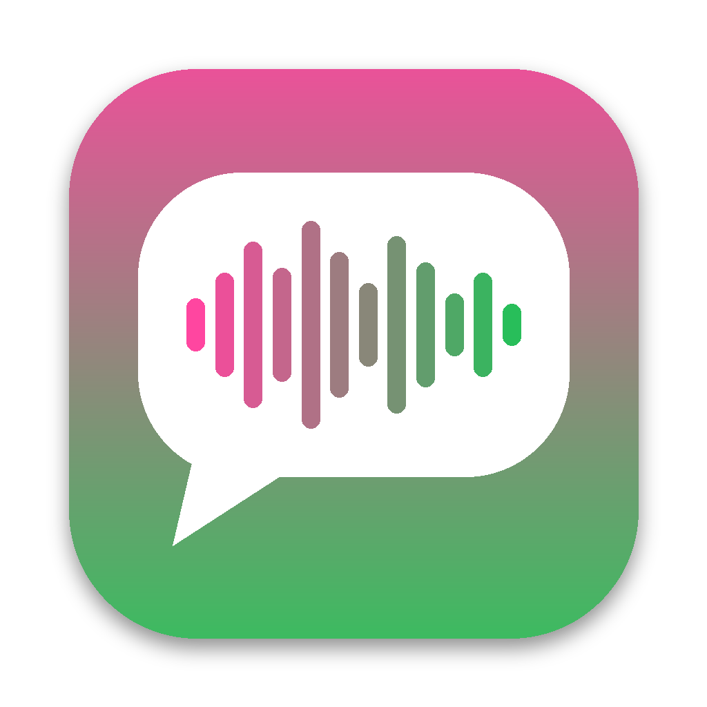

# brainrot-voicemail (Brainrot Voice Memo)

Mac app that turns iMessage voice messages into brainrot videos: your friends' voice messages played over Subway Surfers or Minecraft parkour gameplay, with 1-3 word captions, exported as an iPhone-ready MP4.



## Features

- Lists every iMessage voice message on the Mac, with contact names and group chat names
- Plays them over gameplay video (Subway Surfers, Minecraft parkour, or any video file you pick)
- Reel: add multiple voice messages, reorder them, and merge them into one video
- Captions: word-level timestamps from Apple's on-device speech recognition, shown 1-3 words at a time with the spoken word highlighted
- Export to MP4 in three formats: iPhone full screen (1080x2340), vertical 9:16 (1080x1920), horizontal 16:9 (1920x1080)
- Export renders faster than real time (hardware H.264 encoding via WebCodecs, audio added with AVFoundation)

## Install

1. Download [`dist/Brainrot-Voice-Memo-mac.zip`](dist/Brainrot-Voice-Memo-mac.zip) (or build it, below), unzip, and move the app to Applications.
2. Open it. macOS blocks it the first time because it isn't notarized: System Settings > Privacy & Security > Open Anyway.
3. Grant Full Disk Access when the app asks (needed to read `~/Library/Messages/chat.db`), then Relaunch.
4. Allow Speech Recognition the first time captions run.

Requires macOS 11+, Apple Silicon or Intel. Exports land in `~/Movies/Brainrot Voice Memo/`.

## How it works

| Piece | Implementation |
| --- | --- |
| Window | `NSWindow` + `WKWebView`, driven from C through the Objective-C runtime (`objc_msgSend`) |
| Backend | In-process HTTP server on `127.0.0.1`, serving the UI and a small JSON API |
| Messages | Read-only snapshot of `chat.db` (plus WAL) queried with the system `libsqlite3`; contact names from the AddressBook databases |
| Audio | Voice messages are Opus in CAF; converted to AAC with the built-in `afconvert` and cached |
| Gameplay | Downloaded once with [yt-dlp](https://github.com/yt-dlp/yt-dlp) (fetched on first use) and cached; or a user-picked file |
| Captions | `SFSpeechRecognizer` with `SFSpeechURLRecognitionRequest`, on-device when available |
| Export | Canvas renderer, `VideoEncoder` (H.264), minimal MP4 muxer in JS, then `AVMutableComposition` + `AVAssetExportSession` places each voice clip on the timeline |

The app uses only libraries and tools that ship with macOS. No Xcode project: it is cross-compiled.

## Build

The build runs on Linux (or macOS) with clang and lld. No macOS SDK is needed: the `sdk/` folder holds small `.tbd` stubs for the system libraries the app links against, and `src/main.c` declares the few C and Objective-C runtime functions it uses.

```sh
python3 build.py
# -> out/Brainrot Voice Memo.app and out/Brainrot-Voice-Memo-mac.zip
```

Requirements: `clang` (18+), `ld64.lld-18`, `llvm-lipo-18`, `llvm-nm`, Python 3, `zip`.

`build.py` compiles arm64 and x86_64 slices, links them with `ld64.lld`, ad-hoc signs each slice with `sign.py` (CodeDirectory binding `Info.plist` and `_CodeSignature/CodeResources`, like `codesign -s -`), and combines them with `lipo`. The output is byte-for-byte reproducible.

## Layout

```
src/main.c        native app: window, HTTP server, Messages/Contacts, audio, gameplay, captions, export
src/index.html    UI, renderer, caption chunking, WebCodecs export, MP4 muxer
sign.py           ad-hoc Mach-O code signer
build.py          cross-build, bundle, sign, zip
sdk/*.tbd         link stubs for libSystem, libobjc, libsqlite3, Foundation, AppKit, WebKit, Speech, AVFoundation
assets/           app icon
tests/            Linux build of the backend + headless Chrome UI test
```

## Testing

`tests/run_linux_tests.sh` builds the backend for Linux with AddressSanitizer (the AppKit, Speech and AVFoundation parts are swapped for test stubs and ffmpeg), and `tests/ui_test.py` drives the full UI in headless Chrome: listing, reel, playback, export.

## Limits

- iMessage deletes audio messages 2 minutes after they are played unless you tap Keep or set Settings > Messages > Audio Messages > Expire to Never. Only kept messages show up.
- iOS is not possible: iOS apps cannot read Messages data.
- New builds have a new ad-hoc signature, so macOS may ask for Full Disk Access again after an update.
